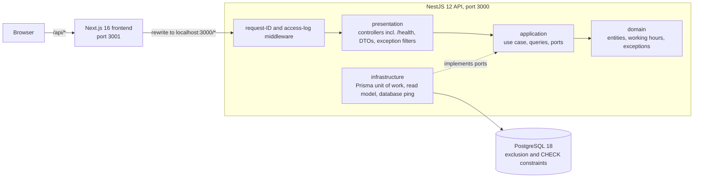
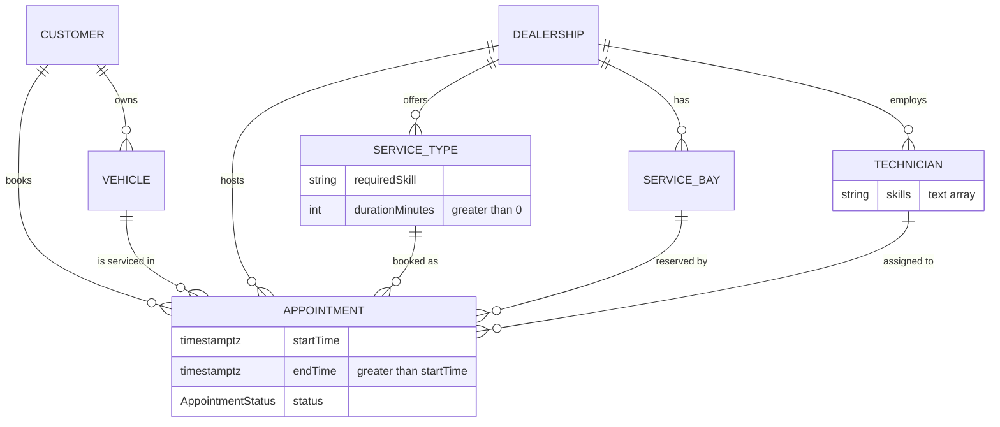
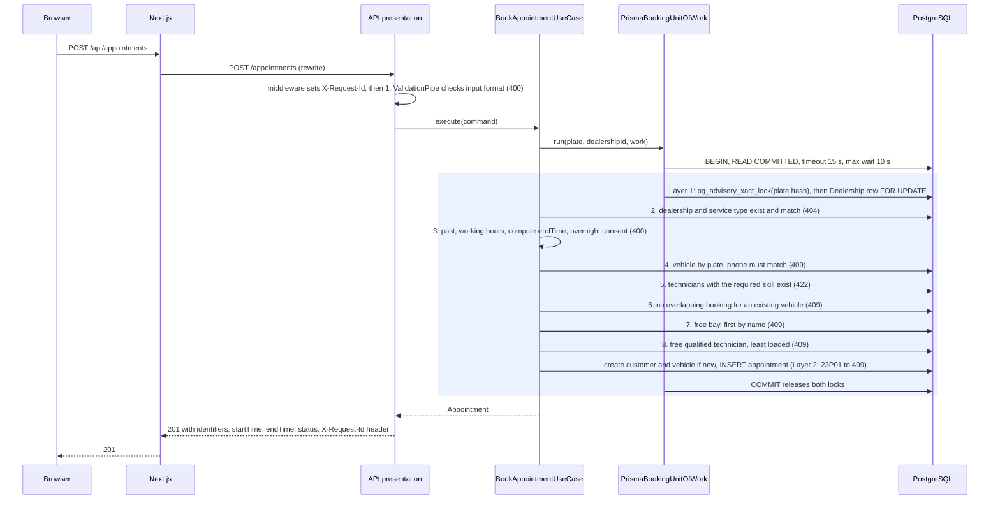

# System Design — The Unified Service Scheduler

A short overview for reviewers. The full spec is [DESIGN.md](DESIGN.md); the decisions are [ADR-0001](adr/0001-tech-stack.md) (backend) and [ADR-0002](adr/0002-frontend-stack.md) (frontend).

## 1. Problem and scope

The brief ([BRIEF.md](BRIEF.md)) asks for an appointment scheduler that replaces manual booking, with three core requirements:

1. "Resource Constrained Booking: Allow a user to request a service appointment for a specific vehicle, service type, and dealership at a desired time."
2. "Real-Time Availability Check: Before confirming, check for the availability of both a ServiceBay and a qualified Technician for the entire service duration."
3. "Confirmed Appointment Record: Upon success, create a persistent Appointment record associating the customer, vehicle, technician, and service bay."

**In the MVP** ([DESIGN Target Deliverables](DESIGN.md#target-deliverables-assumed--resolved), [Read-Only Operations](DESIGN.md#read-only-operations-for-the-booking-frontend-resolved), [Health](DESIGN.md#health-resolved)): the booking API with automatic bay and technician allocation, read-only endpoints for the frontend, a one-page booking and lookup frontend, a health endpoint, and a seed of master data (5 dealerships, 27 bays, 38 technicians, 17 service types in [prisma/seed.ts](../prisma/seed.ts)). Customers and vehicles are created at booking.

**Next phase** ([DESIGN Out of Scope](DESIGN.md#out-of-scope-for-mvp)): on-arrival adjustment of service time, multi-service bookings, nearest-slot suggestions, cancellation and rescheduling, per-vehicle booking limits, technician shifts, breaks and holidays, closed days and holidays, master-data CRUD, notifications, time-slot listing, rate limiting on lookup; metrics and tracing ([O-5](DESIGN.md#o-5--metrics-and-tracing)). Non-goals: authentication and authorization, separate customer and vehicle registration, payment and pricing, mobile, reporting, external integrations.

## 2. Architecture

Sources: [ADR-0002 API access](adr/0002-frontend-stack.md#api-access), [frontend/next.config.ts](../frontend/next.config.ts), [src/app.setup.ts](../src/app.setup.ts), [src/modules/scheduling](../src/modules/scheduling), CLAUDE.md §7 layer rules.

Dependencies point inward. `domain/` and `application/` import no NestJS, Prisma or validation code; NestJS wires them with `useFactory` providers. The rewrite keeps requests same-origin, so the API needs no CORS. Only PostgreSQL runs in Docker ([ADR-0001 erratum](adr/0001-tech-stack.md)).

## 3. Components

| Component | Role | Location |
|---|---|---|
| Browser UI | One page with the booking form and the lookup form | [frontend/app/](../frontend/app) |
| Next.js frontend and rewrite | Serves the UI on port 3001; proxies `/api/*` to the API on port 3000 | [frontend/next.config.ts](../frontend/next.config.ts) |
| Request-observability middleware | Sets `X-Request-Id`, writes one access-log entry per completed request | [request-observability.middleware.ts](../src/shared/presentation/request-observability.middleware.ts) |
| Presentation | Controllers and DTOs; `ValidationPipe` checks input, DTOs map to application commands | [scheduling/presentation/](../src/modules/scheduling/presentation) |
| Exception filters | Domain exceptions to status and `code`; a catch-all gives framework errors the same body | [scheduling-exception.filter.ts](../src/modules/scheduling/presentation/scheduling-exception.filter.ts), [all-exceptions.filter.ts](../src/shared/presentation/all-exceptions.filter.ts) |
| Application | `BookAppointmentUseCase`, `SchedulingQueries`, ports for the unit of work, read model and clock | [scheduling/application/](../src/modules/scheduling/application) |
| Domain | Entities, working-hours rules, plate and phone normalization, domain exceptions | [scheduling/domain/](../src/modules/scheduling/domain) |
| Infrastructure | Prisma unit of work (locks, transaction limits, 23P01 mapping) and read model | [scheduling/infrastructure/database/](../src/modules/scheduling/infrastructure/database) |
| Health endpoint | `GET /health`; database ping with a 2-second timeout | [health.controller.ts](../src/shared/presentation/health.controller.ts), [health-check.ts](../src/shared/presentation/health-check.ts), [database-ping.ts](../src/shared/infrastructure/database/database-ping.ts) |
| PostgreSQL | Stores all data; enforces no-overlap and zero-length guards | [schema.prisma](../prisma/schema.prisma), [migrations](../prisma/migrations) |
| Seed script | Loads master data with fixed ids; safe to re-run; `pnpm db:seed` | [prisma/seed.ts](../prisma/seed.ts) |

## 4. Data model

Sources: [prisma/schema.prisma](../prisma/schema.prisma), [DESIGN Domain Model](DESIGN.md#domain-model).

The six entities an appointment links (I-5) plus `Appointment` itself. A dealership stores local `openTime` / `closeTime` and an IANA `timezone`. Skills are plain strings: a service type needs exactly one, a technician holds one or more (A-6). Plates are stored normalized (uppercase; spaces, `-` and `.` removed) and are unique. There is no login: a plate maps to one phone (A-10), so a second owner booking with another phone is rejected.

**Status (I-6, [OQ-1](DESIGN.md#oq-1--status-machine-scope))**: the enum `AppointmentStatus` is `Confirmed | Cancelled`, never boolean flags. The MVP only creates `Confirmed`. `Cancelled` exists so a future cancel endpoint releases resources: every overlap query and exclusion constraint counts only `status = 'Confirmed'` (I-2).

## 5. Data flow

**Booking** — `POST /appointments`, following the [DESIGN Validation order](DESIGN.md#validation-order-resolved); the first failure is returned. Code: [book-appointment.use-case.ts](../src/modules/scheduling/application/book-appointment.use-case.ts), [prisma-booking-unit-of-work.ts](../src/modules/scheduling/infrastructure/database/prisma-booking-unit-of-work.ts).

A rejection rolls back the whole transaction, so a failed booking creates no customer or vehicle. A transaction timeout (Prisma P2028) returns 503 `SERVICE_BUSY`.

**Other flows** (code: [scheduling-queries.ts](../src/modules/scheduling/application/scheduling-queries.ts), [prisma-scheduling-read-model.ts](../src/modules/scheduling/infrastructure/database/prisma-scheduling-read-model.ts)):

- **Lookup** — `POST /appointments/lookup` → DTO validation → `SchedulingQueries.lookUpAppointments` normalizes plate and phone → read model finds the vehicle → phone must match → that vehicle's appointments, newest first (200), or 404 `APPOINTMENTS_NOT_FOUND`, identical for an unknown plate and a wrong phone. It only reads; no locks.
- **Read-only lists** — `GET /dealerships` and `GET /dealerships/:dealershipId/service-types` → `SchedulingQueries` → read model → 200, or 404 `DEALERSHIP_NOT_FOUND` for an unknown dealership. The frontend uses them to fill the form and to show lookup times in dealership local time.
- **Health** — `GET /health` → `HealthController` → `HealthCheck` runs the `DATABASE_PING` provider (`SELECT 1` on the shared Prisma client) with a 2-second timeout → 200 `{"status":"ok"}` or 503 `DATABASE_UNAVAILABLE`.
- **Request ID** — the middleware runs before the body parser and every route, so every response above, errors included, carries `X-Request-Id`, and its access-log entry uses the same id ([O-2](DESIGN.md#o-2--request-id)). No test covers the header passing through the Next.js rewrite.

## 6. Availability and no double-booking (I-3)

Sources: [ADR-0001 Database](adr/0001-tech-stack.md#database), [migrations](../prisma/migrations), [DESIGN A-15, A-16](DESIGN.md#assumptions).

- **Layer 1, serialise contenders**: a transaction-scoped advisory lock on a 64-bit hash of the normalized plate, then the Dealership row `SELECT … FOR UPDATE`, always in that order, so bookings for the same plate or dealership run one after the other and cannot deadlock. The price is that bookings at one dealership never run in parallel (A-15), judged enough for ~12 bookings/s peak under **Scale A-5, an unsourced assumption** (~500 dealerships, ~16,000–41,000 bookings/day). READ COMMITTED re-snapshots on every statement, so each check sees what the previous lock holder committed, including a new plate's first vehicle.
- **Layer 2, database backstop**: three partial `EXCLUDE USING gist` constraints on `tstzrange("startTime", "endTime", '[)') WHERE status = 'Confirmed'`: `appointment_bay_no_overlap`, `appointment_technician_no_overlap`, `appointment_vehicle_no_overlap`. A violation raises SQLSTATE `23P01`; the adapter maps each constraint name to its 409 code. A bug in Layer 1 cannot produce a double booking.
- **Index**: `Appointment_dealership_range_confirmed_idx`, a partial GiST index on (`dealershipId`, range) for Confirmed rows, serves the per-dealership overlap and workload queries.
- **Zero-length guards (A-16)**: CHECK `service_type_duration_positive` (`durationMinutes > 0`) and `appointment_end_after_start` (`endTime > startTime`). A `[)` range with `endTime = startTime` is empty and overlaps nothing, so a zero-duration service would pass the overlap query and all three exclusion constraints.
- **Checked on submit, not listed**: DESIGN states, "Core Requirement 1 is a request at a desired time, and Core Requirement 2 checks availability before confirming, so availability is checked on booking submission; a slot listing would not remove that check." The cost: a customer may pick a taken time, get a 409, and choose another.

## 7. Time rules

Sources: [DESIGN Invariants](DESIGN.md#invariants), [DESIGN Assumptions](DESIGN.md#assumptions), [working-hours.ts](../src/modules/scheduling/domain/working-hours.ts).

- **Server-computed `endTime` (I-7)**: `startTime` advanced by `durationMinutes` counted in working hours only, stored as one continuous UTC interval, so an overnight service holds its bay and technician through the closed hours. DESIGN's example: "a 2-hour service at 16:00 at a dealership closing at 17:00 → `endTime` = 09:00 the next working day."
- **Overnight consent (I-11)**: when `endTime` falls on a later local date than `startTime`, `overnightConsent` must be `true`, else 400 `OVERNIGHT_CONSENT_REQUIRED`.
- **Local-date judgment**: dates and times of day are judged in the dealership's IANA timezone (seed: `Asia/Ho_Chi_Minh`; no DST, A-4); the API takes and returns UTC with the `Z` suffix, minute-aligned.
- **Start within working hours (I-13)** and **past rejection (I-9)**: a local start before `openTime` or at/after `closeTime` is 400 `OUTSIDE_WORKING_HOURS`; `startTime <= now` (server clock) is 400 `START_TIME_IN_PAST`.

## 8. Allocation

Sources: [DESIGN Assumptions A-2, A-3](DESIGN.md#assumptions), [I-8](DESIGN.md#i-8--same-dealership-resources-resolved).

- **Bay (A-3)**: the first free bay by `name`; seed names are zero-padded ("Bay 01").
- **Technician (A-2)**: the free qualified technician with the fewest Confirmed appointments on the local day of `startTime`; ties by `name`.
- **Same dealership (I-8)**: both come from the appointment's dealership; customers cannot choose them (A-1).

## 9. API and errors

Sources: [DESIGN API Contract](DESIGN.md#api-contract), [scheduling-exception.filter.ts](../src/modules/scheduling/presentation/scheduling-exception.filter.ts), [health-check.ts](../src/shared/presentation/health-check.ts).

- `GET /dealerships` — dealerships with hours and timezone, sorted by name.
- `GET /dealerships/:dealershipId/service-types` — that dealership's service types with `durationMinutes`.
- `POST /appointments` — book; 201 with the created appointment.
- `POST /appointments/lookup` — a vehicle's appointments by `{ licensePlate, phone }`, newest first; POST keeps the phone out of URLs, and a wrong phone gets the same 404 as an unknown plate.
- `GET /health` — 200 `{"status":"ok"}` when the database ping succeeds within 2 seconds, otherwise 503 `DATABASE_UNAVAILABLE`.

Every response carries an `X-Request-Id` header. Every error body is `{ statusCode, code, message, details? }`; `details` lists invalid fields. Clients rely on `code`.

| HTTP | Codes |
|---|---|
| 400 | `VALIDATION_FAILED`, `START_TIME_IN_PAST`, `OUTSIDE_WORKING_HOURS`, `OVERNIGHT_CONSENT_REQUIRED` |
| 404 | `DEALERSHIP_NOT_FOUND`, `SERVICE_TYPE_NOT_FOUND`, `APPOINTMENTS_NOT_FOUND`, `ROUTE_NOT_FOUND` |
| 409 | `PLATE_PHONE_MISMATCH`, `VEHICLE_UNAVAILABLE`, `BAY_UNAVAILABLE`, `TECHNICIAN_UNAVAILABLE` |
| 422 | `NO_QUALIFIED_TECHNICIAN` |
| 503 | `SERVICE_BUSY` (retryable), `DATABASE_UNAVAILABLE` (`GET /health`) |
| 500 | `INTERNAL_ERROR` (generic message; details logged server-side only) |
| other | `REQUEST_REJECTED` (any other framework HTTP error keeps its real status) |

## 10. Technologies

Pinned versions and reasons from [ADR-0001](adr/0001-tech-stack.md#decision) and [ADR-0002](adr/0002-frontend-stack.md#decision).

| Technology and version | Role | Why chosen |
|---|---|---|
| PostgreSQL 18.6 (`postgres:18.6-alpine3.24`, Docker) | Database | Exclusion constraints and row locks enforce no double-booking in the database, the highest-weighted criterion; SQLite has neither. Cost: Docker is required |
| Prisma ORM 7.10.0 with `@prisma/adapter-pg` 7.10.0 | ORM and migrations | Type generation and migration workflow; raw-SQL escape hatches cover `EXCLUDE USING gist` and `FOR UPDATE`. Cost: the constraints, GiST index and A-16 CHECKs are raw SQL in three migrations, invisible to `schema.prisma` |
| NestJS 12.1.3 | HTTP API and dependency injection | Mature DI and modules, global exception filters; `useFactory` wiring keeps domain and application framework-free |
| class-validator 0.15.1, class-transformer 0.5.1 | Input validation | Used only in `presentation/dtos/` through `ValidationPipe` |
| TypeScript 6.0.3, `strict: true` | Language | Pinned below 6.1.0 for the typescript-eslint 8.71.2 peer range |
| Node.js 24.18.0, pnpm 11.13.1 | Runtime, package manager | Current LTS; one workspace install for API and frontend |
| Next.js 16.4.2, React 19.3.1 | Booking frontend | Familiarity gives faster delivery; built-in `rewrites` avoid CORS and any change to the API. Cost: heavier than Vite |
| Native `Intl.DateTimeFormat` | Local time to UTC in the browser | No date-library dependency; correct for Vietnam with no DST. Cost: the backend technique is duplicated, guarded only by shared test cases |
| Jest 30.5.2 (ts-jest 29.4.15; `next/jest` in the frontend), supertest 7.3.1 | Unit and integration tests | Real-database concurrency tests: N parallel requests, exactly one succeeds |
| Playwright 1.64.1 (Chromium) | E2E smoke tests | Added when both flows worked (ADR-0002 Amendment 1); outside `verify` |
| ESLint 10.12.0, typescript-eslint 8.71.2 | Lint | Enforces `@typescript-eslint/no-explicit-any: error` |

## 11. Observability

Sources: [DESIGN Observability](DESIGN.md#observability-resolved), [src/shared](../src/shared).

**Implemented** (O-1 to O-4, tested by T8.1–T8.19):

- **O-1 JSON logs** — `main.ts` uses `createAppLogger()`, a `ConsoleLogger` with `json: true`: one JSON line per message, with its context. No new packages.
- **O-2 Request ID** — a valid incoming `X-Request-Id` (`^[A-Za-z0-9._-]{1,64}$`) is reused, otherwise a UUID v4 is generated; every response, including errors and malformed-JSON 400s, returns it.
- **O-3 Access log** — one entry per completed request: `requestId`, `method`, path without query string, `statusCode`, `durationMs`, and `code` for errors; level `log` below 500, `error` from 500. Bodies, `phone`, `licensePlate` and `name` are never logged; tests check logger calls, stdout, stderr and console during a booking and a lookup.
- **O-4 Health** — `GET /health` pings the database with a 2-second timeout; a failure or timeout returns 503 `DATABASE_UNAVAILABLE` in the standard body, and the ping error is logged, not returned.

**Strategy, next phase** (O-5). Every item below is **proposed, not built**; any new package needs approval (CLAUDE.md §8.2).

- **Metrics (proposed)**: request rate and latency per method, path and status, from the same fields the access log already writes (`durationMs`, `statusCode`); counters per error `code`, especially `SERVICE_BUSY` (lock wait or transaction timeout) and `BAY_UNAVAILABLE` / `TECHNICIAN_UNAVAILABLE` (demand above capacity); the `/health` result.
- **Tracing (proposed)**: `X-Request-Id` is already the correlation id between a response and its log line; next, send it from the frontend and carry it into database calls and spans with a tracing library.
- **Alerting (proposed)**: alert when `/health` returns 503, when `error`-level access entries (5xx) rise, and when the `SERVICE_BUSY` rate rises.

## 12. Build for the future

- **Scalability** — contention is local to one dealership and time window (A-5), and the locks are per plate and per dealership, so bookings at different dealerships wait for each other only when they share a plate. Next: revisit the dealership lock scope if contention grows (A-15); ADR-0001 revisits Redis if a future slot-browsing endpoint misses latency targets after indexing and read replicas, or when per-vehicle rate limiting is built across multiple API instances.
- **Performance** — the partial GiST index serves the overlap and workload queries (WORK_LOG 2026-10-18 17:17: `EXPLAIN` uses it), `Appointment` also has an index on (`vehicleId`, `startTime`), and one `Intl` formatter is cached per timezone. Next: the lock scope and slot-browsing read paths above.
- **Reliability** — the database itself rejects overlaps (Layer 2), a failed booking rolls back completely, transaction limits (15 s timeout, 10 s wait) turn lock exhaustion into a retryable 503, and `GET /health` reports database reachability within 2 seconds. Next: the ping query is not cancelled after its timeout (section 15).
- **Maintainability** — module-first layers, a framework-free domain and application behind ports, pinned versions, numbered test cases for every behaviour, one `pnpm verify` gate. Next: the duplicated time conversion (ADR-0002).
- **Observability** — JSON logs, request IDs and a personal-data-free access log are built and tested (section 11). Next: the proposed metrics, tracing and alerting.

## 13. Testing

Counts from fresh runs of `pnpm verify` and `pnpm test:integration` on 2026-10-18; all passed. Sources: [package.json](../package.json), [tests](../tests), [frontend/tests](../frontend/tests), [e2e](../e2e).

| Level | Tests | Command |
|---|---|---|
| Backend unit (domain, use case, DTOs, filter; request ID, access-log entry, health check) | 115 in 9 suites (20 observability) | `pnpm test` |
| Frontend unit (time, slots, errors, payloads) | 104 in 6 suites | `pnpm --filter frontend test` |
| Integration (real PostgreSQL `scheduler_test`, HTTP via supertest) | 118 in 7 suites (17 observability) | `pnpm test:integration` |
| E2E (Playwright, Chromium; not in `verify`) | 6 in 2 specs | `pnpm test:e2e` |

`pnpm verify` runs typecheck, lint, both unit levels, `prisma validate` and both builds. The observability tests are [tests/unit/shared](../tests/unit/shared) and [observability.http.spec.ts](../tests/integration/observability/observability.http.spec.ts) (T8.1–T8.19).

**Proof of I-3**: in [booking-concurrency](../tests/integration/scheduling/booking-concurrency.integration.spec.ts), T3.5–T3.7 and T3.9 fire N = 10 parallel bookings through the use case on a real database and exactly one wins; T3.10–T3.13 and T3.19 race two (same vehicle at two dealerships with no deadlock, same new plate, two new plates for the last bay); T3.8 shows no false contention. [booking-unit-of-work](../tests/integration/scheduling/booking-unit-of-work.integration.spec.ts) covers rollback (T3.14) and the 23P01 mapping (T3.16); [schema-constraints](../tests/integration/scheduling/schema-constraints.integration.spec.ts) proves with raw SQL that the exclusion constraints (T3.15) and A-16 guards (T3.20–T3.21) hold without the application.

## 14. GenAI in the design phase

The spec and both stack ADRs were produced with Claude Code under a harness that keeps the engineer in charge of every decision; from 2026-10-17 12:11 to 18:07 (Rounds 3b–7), the engineer drafted or updated the test-case lists with an external Claude chat, and each round was then run under the harness with `/tdd-round`. Sources: [CLAUDE.md](../CLAUDE.md), [.claude/skills](../.claude/skills), [.claude/agents](../.claude/agents), [.claude/hooks](../.claude/hooks), [PROMPT_LOG](PROMPT_LOG.md), [WORK_LOG](WORK_LOG.md).

- **Rules** — CLAUDE.md fixes the phases (spec, stack ADR, scaffold, implement), spec before code, stop-and-ask on business rules, no packages without approval, evidence before "done", a verbatim prompt log and a one-row-per-decision work log.
- **Skills** — `/spec-review` challenges the engineer's understanding, never editing DESIGN.md; `/spec-record` writes only restated decisions into named sections; `/adr` challenges the stack evaluation, then writes the ADR as Proposed; `/tdd-round` runs one test-case section through Red, red gate, Green, verify and review.
- **Subagents** — `red-gate` checks new tests fail for the right reason; `reviewer` checks the diff against DESIGN.md, the ADRs and CLAUDE.md. Both are read-only; a hook limits the reviewer to read-only git and the verify scripts.
- **Hooks and permissions** — `block-git-write.js` blocks every git command that writes history (commit, push, reset and others), so the engineer stages and commits; settings deny reading `.env` files and editing the hooks.

Examples from the logs:

| Date | What happened | Log |
|---|---|---|
| 2026-10-16 15:56 | `/spec-review` returned a 15-point tag table, 10 blockers and 10 questions; the engineer's answers (working-hours model, per-dealership hours and timezone, technician preference) were then recorded with `/spec-record` | WORK_LOG |
| 2026-10-16 18:04 | `/adr docs/drafts/stack-evaluation.md`: the AI raised 4 challenges, the engineer answered them, and ADR-0001 was written as Proposed; the engineer approved `@prisma/adapter-pg` | WORK_LOG, PROMPT_LOG |
| 2026-10-17 07:42 | `/spec-record` stopped because the draft file marked its decisions as not yet agreed; nothing was recorded until the agreed re-run at 07:55 | WORK_LOG |
| 2026-10-17 11:32 | AI output proven wrong: the red gate found that the integration test files, run in parallel by the `test:integration` script the AI wrote at scaffold (2026-10-16), truncated each other's shared database; the fix needed `package.json`, outside the allowed list, so Round 3b stopped for the engineer | WORK_LOG (also 2026-10-16 18:56 for the script) |
| 2026-10-17 12:11 – 18:07 | The engineer drafted or updated the test-case lists for Rounds 3c, 4c, 5, 6 and 7 with an external Claude chat, then ran each with `/tdd-round` | WORK_LOG |
| 2026-10-17 14:30–14:34 | Reviewer caught an Important finding: framework errors (malformed JSON, 500, unknown route) bypassed the error format; the rule went into DESIGN.md with `/spec-record` before the code changed | WORK_LOG |

## 15. Known limitations and next steps

- **Next phase**: the full list in section 1 ([DESIGN](DESIGN.md#out-of-scope-for-mvp)), plus the proposed metrics, tracing and alerting (section 11).
- **Dealership lock scope (A-15)**: the dealership row lock is held across the whole booking transaction; revisit if per-dealership contention grows.
- **No authentication or rate limiting**: authentication is a non-goal; lookup rate limiting and per-vehicle booking limits are next phase.
- **`PLATE_PHONE_MISMATCH` reveals a known plate**: booking with an existing plate and another phone returns 409, which tells the caller the plate is registered (lookup hides this with an identical 404).
- **Health ping keeps running**: after the 2-second timeout `GET /health` answers 503, but the `SELECT 1` query itself is not cancelled ([health-check.ts](../src/shared/presentation/health-check.ts)).
- **Client disconnect**: a request whose client disconnects before the response finishes writes no access-log line; the booking itself is still recorded ([O-3](DESIGN.md#o-3--access-log)).
- **Test output**: `pnpm test:integration` prints `ERROR [AccessLog]` and `ERROR [AllExceptionsFilter]` lines (with a stack trace) from tests that trigger 500 and 503 on purpose; this is expected (WORK_LOG 2026-10-18 20:57).
- **Frontend date strip**: the 14-day strip is computed when the dealership is picked ([booking-form.tsx](../frontend/app/booking-form.tsx)), so a page left open past midnight starts on a stale day. The API still rejects past start times.
- **Shared test database**: E2E and integration tests both use `scheduler_test`; run them one at a time ([ADR-0002 Amendment 1](adr/0002-frontend-stack.md#amendment-1--e2e-smoke-tests-2026-10-18)).
