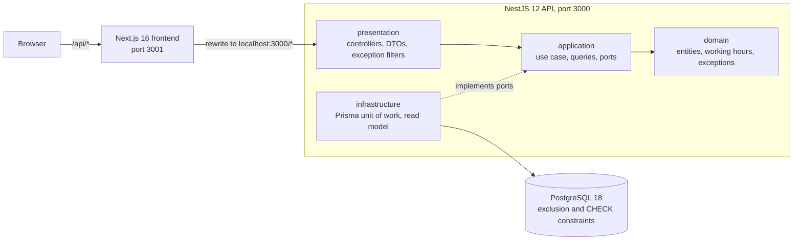
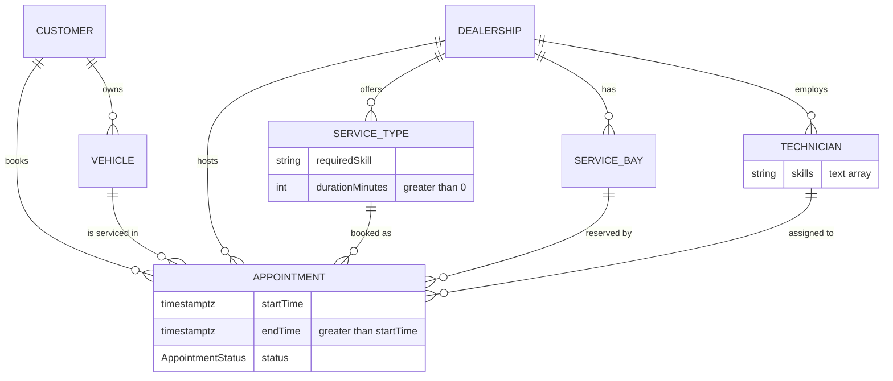
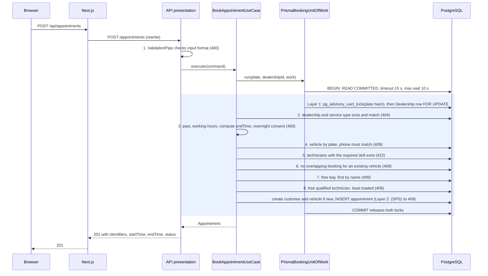

# System Design — The Unified Service Scheduler

A 10-minute overview for reviewers. The full spec is [DESIGN.md](DESIGN.md); the decisions are [ADR-0001](adr/0001-tech-stack.md) (backend) and [ADR-0002](adr/0002-frontend-stack.md) (frontend).

## 1. Problem and scope

The brief ([BRIEF.md](BRIEF.md)) asks for an appointment scheduler that replaces manual booking, with three core requirements:

1. "Resource Constrained Booking: Allow a user to request a service appointment for a specific vehicle, service type, and dealership at a desired time."
2. "Real-Time Availability Check: Before confirming, check for the availability of both a ServiceBay and a qualified Technician for the entire service duration."
3. "Confirmed Appointment Record: Upon success, create a persistent Appointment record associating the customer, vehicle, technician, and service bay."

**In the MVP** ([DESIGN Target Deliverables](DESIGN.md#target-deliverables-assumed--resolved)): the booking API with automatic bay and technician allocation, read-only endpoints for the frontend, a one-page booking and lookup frontend, and a seed of master data (5 dealerships, 27 bays, 38 technicians, 17 service types in [prisma/seed.ts](../prisma/seed.ts)). Customers and vehicles are created at booking.

**Next phase** ([DESIGN Out of Scope](DESIGN.md#out-of-scope-for-mvp)): on-arrival adjustment of service time, multi-service bookings, nearest-slot suggestions, cancellation and rescheduling, per-vehicle booking limits, technician shifts, breaks and holidays, closed days and holidays, master-data CRUD, notifications, time-slot listing, rate limiting on lookup. Non-goals: authentication and authorization, separate customer and vehicle registration, payment and pricing, mobile, reporting, external integrations.

## 2. Architecture

Sources: [ADR-0002 API access](adr/0002-frontend-stack.md#api-access), [frontend/next.config.ts](../frontend/next.config.ts), [src/modules/scheduling](../src/modules/scheduling), CLAUDE.md §7 layer rules.

Dependencies point inward. `domain/` and `application/` import no NestJS, Prisma or validation code; NestJS wires them with `useFactory` providers. The rewrite keeps requests same-origin, so the API needs no CORS. Only PostgreSQL runs in Docker ([ADR-0001 erratum](adr/0001-tech-stack.md)).

## 3. Data model

Sources: [prisma/schema.prisma](../prisma/schema.prisma), [DESIGN Domain Model](DESIGN.md#domain-model).

The six entities an appointment links (I-5) plus `Appointment` itself. A dealership stores local `openTime` / `closeTime` and an IANA `timezone`. Skills are plain strings: a service type needs exactly one, a technician holds one or more (A-6). Plates are stored normalized (uppercase; spaces, `-` and `.` removed) and are unique.

**Status (I-6, [OQ-1](DESIGN.md#oq-1--status-machine-scope))**: the enum `AppointmentStatus` is `Confirmed | Cancelled`, never boolean flags. The MVP only creates `Confirmed`. `Cancelled` exists so a future cancel endpoint releases resources: every overlap query and exclusion constraint counts only `status = 'Confirmed'` (I-2).

## 4. Booking flow

`POST /appointments`, following the [DESIGN Validation order](DESIGN.md#validation-order-resolved); the first failure is returned. Code: [book-appointment.use-case.ts](../src/modules/scheduling/application/book-appointment.use-case.ts), [prisma-booking-unit-of-work.ts](../src/modules/scheduling/infrastructure/database/prisma-booking-unit-of-work.ts).

A rejection rolls back the whole transaction, so a failed booking creates no customer or vehicle. A transaction timeout (Prisma P2028) returns 503 `SERVICE_BUSY`.

## 5. Availability and no double-booking (I-3)

Sources: [ADR-0001 Database](adr/0001-tech-stack.md#database), [migrations](../prisma/migrations), [DESIGN A-15, A-16](DESIGN.md#assumptions).

- **Layer 1, serialise contenders**: each booking transaction takes a transaction-scoped advisory lock on a 64-bit hash of the normalized plate, then locks the Dealership row with `SELECT … FOR UPDATE`, always in that order. Bookings for the same plate or the same dealership run one after the other, and the fixed order rules out deadlock. READ COMMITTED re-snapshots on every statement, so each check sees bookings committed by the previous lock holder, including a new plate's first vehicle.
- **Layer 2, database backstop**: three partial `EXCLUDE USING gist` constraints on `tstzrange("startTime", "endTime", '[)') WHERE status = 'Confirmed'`: `appointment_bay_no_overlap`, `appointment_technician_no_overlap`, `appointment_vehicle_no_overlap`. A violation raises SQLSTATE `23P01`; the adapter maps each constraint name to its 409 code. A bug in Layer 1 cannot produce a double booking.
- **Index**: `Appointment_dealership_range_confirmed_idx`, a partial GiST index on (`dealershipId`, range) for Confirmed rows, serves the per-dealership overlap and workload queries.
- **Zero-length guards (A-16)**: CHECK `service_type_duration_positive` (`durationMinutes > 0`) and `appointment_end_after_start` (`endTime > startTime`). A `[)` range with `endTime = startTime` is empty and overlaps nothing, so a zero-duration service would pass the overlap query and all three exclusion constraints.
- **Checked on submit, not listed**: DESIGN states, "Core Requirement 1 is a request at a desired time, and Core Requirement 2 checks availability before confirming, so availability is checked on booking submission; a slot listing would not remove that check."

## 6. Time rules

Sources: [DESIGN Invariants](DESIGN.md#invariants), [working-hours.ts](../src/modules/scheduling/domain/working-hours.ts).

- **Server-computed `endTime` (I-7)**: `startTime` advanced by `durationMinutes` counted in working hours only, stored as one continuous UTC interval; bay and technician are held for all of it. DESIGN's example: "a 2-hour service at 16:00 at a dealership closing at 17:00 → `endTime` = 09:00 the next working day."
- **Overnight consent (I-11)**: when `endTime` falls on a later local date than `startTime`, `overnightConsent` must be `true`, else 400 `OVERNIGHT_CONSENT_REQUIRED`.
- **Local-date judgment**: dates and times of day are judged in the dealership's IANA timezone (seed: `Asia/Ho_Chi_Minh`; no DST, A-4); the API takes and returns UTC with the `Z` suffix, minute-aligned.
- **Start within working hours (I-13)**: a local start before `openTime` or at/after `closeTime` is 400 `OUTSIDE_WORKING_HOURS`.
- **Past rejection (I-9)**: `startTime <= now` (server clock) is 400 `START_TIME_IN_PAST`.

## 7. Allocation

Sources: [DESIGN Assumptions A-2, A-3](DESIGN.md#assumptions), [I-8](DESIGN.md#i-8--same-dealership-resources-resolved).

- **Bay (A-3)**: the first free bay in ascending `name` order. Seed names are zero-padded ("Bay 01") so text order equals numeric order.
- **Technician (A-2)**: among free technicians holding the required skill, the one with the fewest Confirmed appointments overlapping the local calendar day of `startTime`; ties broken by ascending `name`.
- **Same dealership (I-8)**: bays and technicians are only drawn from the appointment's dealership. Customers cannot choose them (A-1).

## 8. API and errors

Sources: [DESIGN API Contract](DESIGN.md#api-contract), [scheduling-exception.filter.ts](../src/modules/scheduling/presentation/scheduling-exception.filter.ts).

- `GET /dealerships` — dealerships with hours and timezone, sorted by name.
- `GET /dealerships/:dealershipId/service-types` — that dealership's service types with `durationMinutes`.
- `POST /appointments` — book; 201 with the created appointment.
- `POST /appointments/lookup` — a vehicle's appointments by `{ licensePlate, phone }`, newest first; POST keeps the phone out of URLs, and a wrong phone gets the same 404 as an unknown plate.

Every error body is `{ statusCode, code, message, details? }`; `details` lists invalid fields. Clients rely on `code`.

| HTTP | Codes |
|---|---|
| 400 | `VALIDATION_FAILED`, `START_TIME_IN_PAST`, `OUTSIDE_WORKING_HOURS`, `OVERNIGHT_CONSENT_REQUIRED` |
| 404 | `DEALERSHIP_NOT_FOUND`, `SERVICE_TYPE_NOT_FOUND`, `APPOINTMENTS_NOT_FOUND`, `ROUTE_NOT_FOUND` |
| 409 | `PLATE_PHONE_MISMATCH`, `VEHICLE_UNAVAILABLE`, `BAY_UNAVAILABLE`, `TECHNICIAN_UNAVAILABLE` |
| 422 | `NO_QUALIFIED_TECHNICIAN` |
| 503 | `SERVICE_BUSY` (retryable) |
| 500 | `INTERNAL_ERROR` (generic message; details logged server-side only) |
| other | `REQUEST_REJECTED` (any other framework HTTP error keeps its real status) |

## 9. Key trade-offs

| Decision | Chosen | Trade-off accepted |
|---|---|---|
| Database ([ADR-0001](adr/0001-tech-stack.md#database)) | PostgreSQL, not SQLite | Docker is required; database-enforced no-overlap was weighted over zero-config setup. |
| Double-booking guard ([ADR-0001](adr/0001-tech-stack.md#redis-considered-not-included)) | Row and advisory locks plus exclusion constraints, no Redis | Bookings for one dealership run one at a time, and the dealership lock is held for the whole transaction (A-15). Judged enough for ~12 bookings/s peak under **Scale A-5, an unsourced assumption** (~500 dealerships, ~16,000–41,000 bookings/day). |
| ORM ([ADR-0001](adr/0001-tech-stack.md#negative--trade-offs-accepted)) | Prisma | Exclusion constraints, the GiST index and the A-16 CHECKs are raw SQL in three migrations, invisible to `schema.prisma`. |
| Service time ([I-7](DESIGN.md#i-7--working-hours-endtime-resolved)) | One continuous interval over working hours | An overnight service holds its bay and technician through the closed hours. |
| Availability ([DESIGN](DESIGN.md#out-of-scope-for-mvp)) | Checked on submit; no slot listing | A customer may pick a taken time and get a 409, then choose another. |
| Identity ([A-10](DESIGN.md#assumptions)) | Plate plus phone, no login | One plate maps to one phone; a second owner's phone is rejected. |
| Frontend ([ADR-0002](adr/0002-frontend-stack.md#negative--trade-offs-accepted)) | Next.js with `rewrites` | Heavier than Vite; chosen for delivery time and to leave the API unchanged (no CORS). |
| Time conversion ([ADR-0002](adr/0002-frontend-stack.md#time-handling)) | Native `Intl` in the browser | The backend technique is duplicated; drift is guarded only by testing both against the same cases. |

## 10. Testing

Counts from fresh runs of `pnpm verify` and `pnpm test:integration` on 2026-10-18; all passed. Sources: [package.json](../package.json), [tests](../tests), [frontend/tests](../frontend/tests), [e2e](../e2e).

| Level | Tests | Command |
|---|---|---|
| Backend unit (domain, use case, DTOs, filter) | 95 in 6 suites | `pnpm test` |
| Frontend unit (time, slots, errors, payloads) | 104 in 6 suites | `pnpm --filter frontend test` |
| Integration (real PostgreSQL `scheduler_test`, HTTP via supertest) | 101 in 6 suites | `pnpm test:integration` |
| E2E (Playwright, Chromium; not in `verify`) | 6 in 2 specs | `pnpm test:e2e` |

`pnpm verify` runs typecheck, lint, both unit levels, `prisma validate` and both builds.

**Proof of I-3**: in [booking-concurrency](../tests/integration/scheduling/booking-concurrency.integration.spec.ts), T3.5–T3.7 and T3.9 fire N = 10 parallel bookings through the use case on a real database and exactly one wins the last bay, technician or vehicle slot; T3.10–T3.13 and T3.19 race two (same vehicle at two dealerships with no deadlock, same new plate, two new plates for the last bay); T3.8 shows no false contention. In [booking-unit-of-work](../tests/integration/scheduling/booking-unit-of-work.integration.spec.ts), T3.14 covers rollback and T3.16 maps 23P01 to the domain exception (409 via the filter). In [schema-constraints](../tests/integration/scheduling/schema-constraints.integration.spec.ts), T3.15 inserts raw SQL to prove the exclusion constraints hold without the application, and T3.20–T3.21 do the same for the A-16 guards.

## 11. Known limitations and next steps

- **Next phase**: the full list in section 1 ([DESIGN](DESIGN.md#out-of-scope-for-mvp)).
- **Dealership lock scope (A-15)**: the dealership row lock is held across the whole booking transaction; revisit if per-dealership contention grows.
- **No authentication or rate limiting**: authentication is a non-goal; lookup rate limiting and per-vehicle booking limits are next phase.
- **`PLATE_PHONE_MISMATCH` reveals a known plate**: booking with an existing plate and another phone returns 409, which tells the caller the plate is registered (lookup hides this with an identical 404).
- **Frontend date strip**: the 14-day strip is computed when the dealership is picked ([booking-form.tsx](../frontend/app/booking-form.tsx)), so a page left open past midnight starts on a stale day. The API still rejects past start times.
- **Shared test database**: E2E and integration tests both use `scheduler_test`; run them one at a time ([ADR-0002 Amendment 1](adr/0002-frontend-stack.md#amendment-1--e2e-smoke-tests-2026-10-18)).
